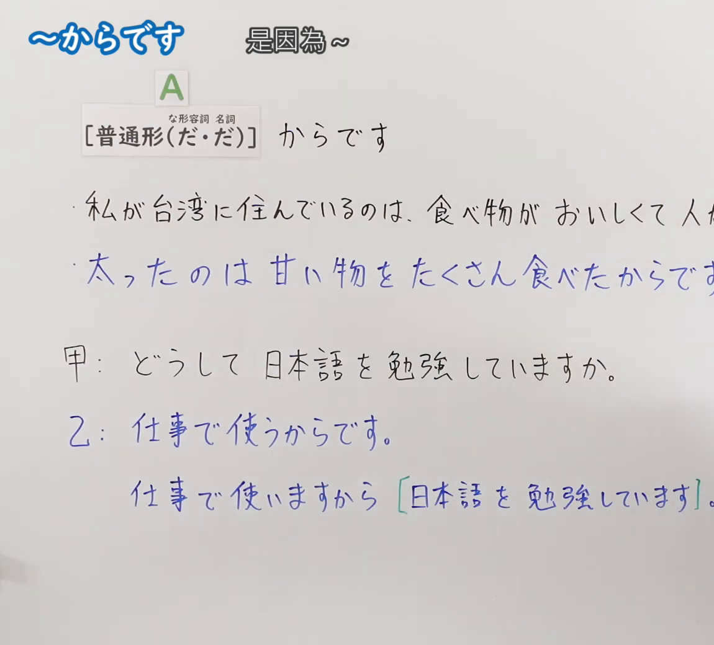
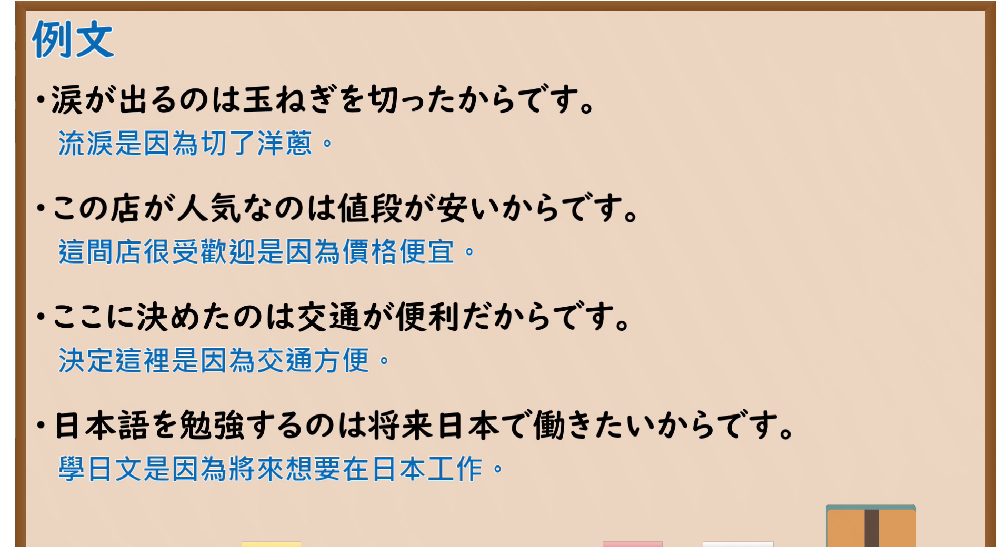

---
{
  "id": "N5-G-0112",
  "kind": "grammar",
  "level": "N5",
  "title": "～からです",
  "card_revision": 2,
  "schema_version": 1,
  "source": {
    "lesson": "N5 第112个语法",
    "material": "出口日語原视频板书（学习者截取的接续图与例句图）与J-nihongo「～から（理由）の意味・使い方」正文",
    "video": "https://www.youtube.com/watch?v=M2ACwSXE_FI",
    "screenshot": "assets/grammar/n5/N5-G-0112-connection.png",
    "screenshot_crop": {
      "x": 0,
      "y": 0,
      "width": 1150,
      "height": 1040
    }
  },
  "tags": [
    "からです",
    "理由",
    "原因",
    "N5"
  ],
  "confusions": [
    "から／ので",
    "のは～からです",
    "普通形＋からです",
    "理由／原因"
  ]
}
---

# N5 第112个语法：～からです

# 视频学习资料整理

- 课程：[出口日語「～からです」](https://www.youtube.com/watch?v=M2ACwSXE_FI)
- 视频 ID：`M2ACwSXE_FI`
- 视频时长：4分39秒

## 接续图

- 实际时间：未记录（图片由学习者从原视频截取并提供）
- 成品图尺寸：1150×1040，固定左上角 `(0, 0)`，右下角 `(1150, 1040)`
- 板书内容：标题「～からです」，右侧标注“是因為～”；公式「A：［普通形（だ・だ）］（な形容词、名词用「だ」）からです」；例句：「私が台湾に住んでいるのは、食べ物がおいしくて人（が親切だからです）」（被截断）「太ったのは甘い物をたくさん食べたからです」（蓝字，被截断）；对话「甲：どうして日本語を勉強していますか。」「乙：仕事で使うからです。」「仕事で使いますから［日本語を勉強しています］。」（绿框）。右侧多处句末被画面右缘截断，未补写。

## 例句图

- 实际时间：未记录（图片由学习者从原视频截取并提供）
- 成品图尺寸：1900×1040，固定左上角 `(0, 0)`，右下角 `(1900, 1040)`
- 板书内容：课程「例文」页，含四条例句及中文翻译（涙が出るのは玉ねぎを切ったからです／この店が人気なのは値段が安いからです／ここに決めたのは交通が便利だからです／日本語を勉強するのは将来日本で働きたいからです）。四条例句均完整可见。

# 核心

## 功能一：是因为～（说明原因、理由）

**くわしい意味記述：**

- **～から（理由）：** 判断や行動の理由・原因を「から」の前に示します。（把判断或行动的理由、原因放在「から」之前。）

### 例句

1. 雨が降っているから、傘を持っていきます。

   （因为在下雨，所以带伞去。）

2. 明日は休みだから、少し遅く起きます。

   （明天休息，所以晚一点起床。）

3. 私は日本が好きです。食べ物がおいしいですから。

   （我喜欢日本。因为食物好吃。）

4. 宿題がありますから、今日は遊びに行きません。

   （因为有作业，所以今天不出去玩。）

5. もう11時ですから帰りますね。

   （已经11点了，所以我回去了。）

# 来源

- [出口日語原视频](https://www.youtube.com/watch?v=M2ACwSXE_FI)
- [J-nihongo「～から（理由）の意味・使い方」](https://j-nihongo.com/kara-reason/)（查询日期：2026-10-16；Hagoromo、毎日のんびり日本語教師均未找到直接对应条目，按流程采用互联网检索所得的该页；该页只有英文翻译，中文译文为整理者所译；该页例句是「～から、～」「～ですから」，没有板书中「～のは～からです」的句型，卡内如实照录；与第 46 课「から」的说明相近）
