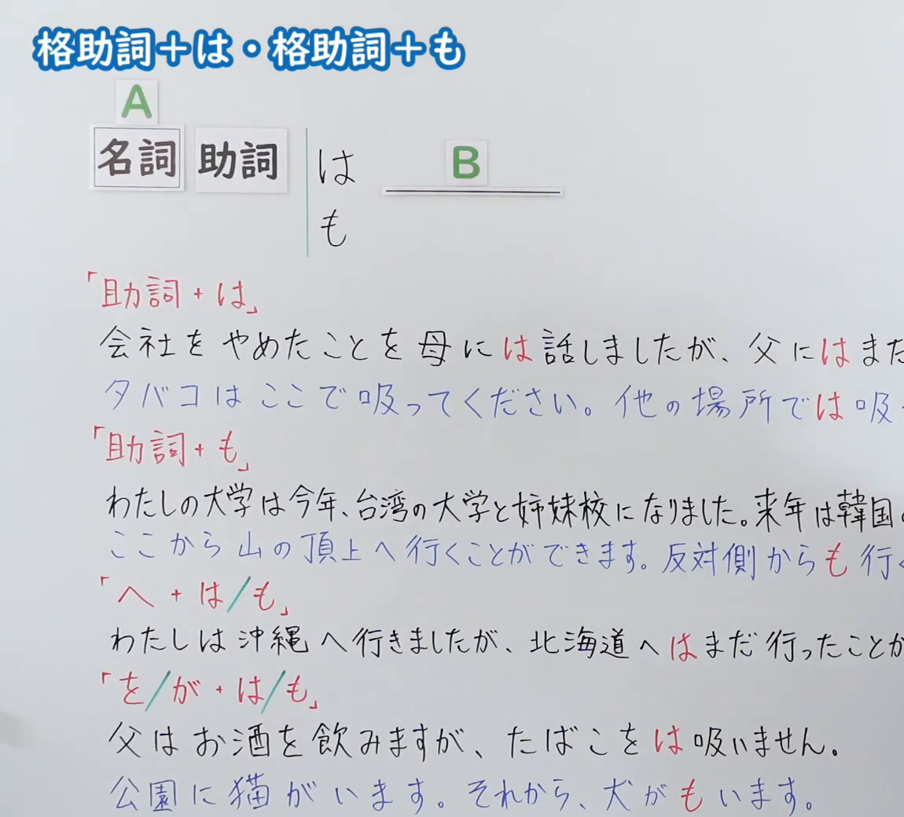
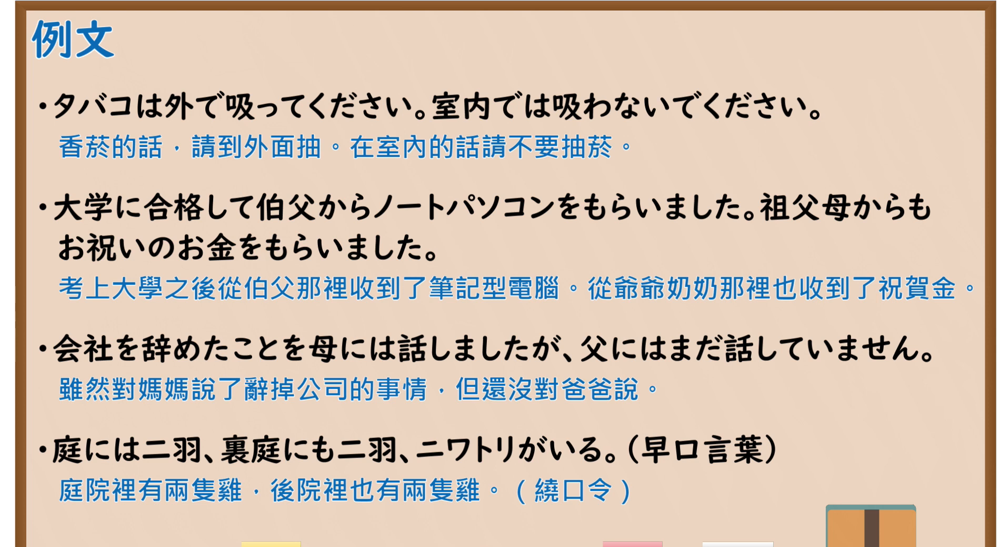

---
{
  "id": "N5-G-0113",
  "kind": "grammar",
  "level": "N5",
  "title": "格助词＋は・格助词＋も",
  "card_revision": 2,
  "schema_version": 1,
  "source": {
    "lesson": "N5 第113个语法",
    "material": "出口日語原视频板书（学习者截取的接续图与例句图）与东京外国语大学「副助詞：解説」「格助詞：解説」正文",
    "video": "https://www.youtube.com/watch?v=No6oF-Pkd-o",
    "screenshot": "assets/grammar/n5/N5-G-0113-connection.png",
    "screenshot_crop": {
      "x": 0,
      "y": 0,
      "width": 1150,
      "height": 1040
    }
  },
  "tags": [
    "は",
    "も",
    "格助词",
    "N5"
  ],
  "confusions": [
    "には／にも",
    "からは／からも",
    "へは／へも",
    "をは→を",
    "がは→が"
  ]
}
---

# N5 第113个语法：格助词＋は・格助词＋も

# 视频学习资料整理

- 课程：[出口日語「格助詞＋は・格助詞＋も」](https://www.youtube.com/watch?v=No6oF-Pkd-o)
- 视频 ID：`No6oF-Pkd-o`
- 视频时长：10分1秒

## 接续图

- 实际时间：未记录（图片由学习者从原视频截取并提供）
- 成品图尺寸：1150×1040，固定左上角 `(0, 0)`，右下角 `(1150, 1040)`
- 板书内容：标题「格助詞＋は・格助詞＋も」；公式「A：名詞 助詞 は／も B：＿＿」；「助詞＋は」：「会社をやめたことを母には話しましたが、父にはまだ（話していません）」「タバコはここで吸ってください。他の場所では吸（わないでください）」；「助詞＋も」：「わたしの大学は今年、台湾の大学と姉妹校になりました。来年は韓国（の…）」「ここから山の頂上へ行くことができます。反対側からも行く（ことができます）」；「へ＋は／も」：「わたしは沖縄へ行きましたが、北海道へはまだ行ったことが（ありません）」；「を／が＋は／も」：「父はお酒を飲みますが、たばこをは吸いません。」「公園に猫がいます。それから、犬がもいます。」；右侧多处句末被画面右缘截断，未补写。板书「たばこをは」「犬がも」是示意；来源页指出这类情形「を」「が」会消失。

## 例句图

- 实际时间：未记录（图片由学习者从原视频截取并提供）
- 成品图尺寸：1900×1040，固定左上角 `(0, 0)`，右下角 `(1900, 1040)`
- 板书内容：课程「例文」页，含四条例句及中文翻译（タバコは外で吸ってください。室内では吸わないでください／大学に合格して伯父からノートパソコンをもらいました。祖父母からもお祝いのお金をもらいました／会社を辞めたことを母には話しましたが、父にはまだ話していません／庭には二羽、裏庭にも二羽、ニワトリがいる（早口言葉））。四条例句均完整可见。

# 核心

## 功能一：格助词后加「は」表示对比，加「も」表示追加（同样）

**くわしい意味記述：**

- **「は」（対比）：** 「～は」を含むことがらを、他のことがらと対比する意味を付け加えます。（附加把含「～は」的事项与其他事项对比的意义。）
- **「も」（並立・付加）：** 「～も」を含むことがらに、「他のことがらと同様にこのことがらが成立する」という意味（並立・付加）を付け加えます。（给含「～も」的事项附加“与其他事项同样成立”的意义（并列、追加）。）
- **格助詞との関係：** 副助詞がつく場合には、「が」「を」は現れません。（加副助词时，「が」「を」不出现。）

### 例句

1. ここにえんぴつがあります。赤いえんぴつは３本あります。青いえんぴつは２本あります。

   （这里有铅笔。红铅笔有3支，蓝铅笔有2支。）

2. 山田さんはドイツ語は上手です。（フランス語は上手ではありません。）

   （山田德语很好。（法语不好。））

3. 田中さんは学生です。佐藤さんも学生です。

   （田中是学生。佐藤也是学生。）

4. 暖かくなりましたし、桜も咲きました。

   （变暖和了，樱花也开了。）

5. きょうのコンサートには100人も来ました。

   （今天的音乐会来了多达100人。）

# 来源

- [出口日語原视频](https://www.youtube.com/watch?v=No6oF-Pkd-o)
- [东京外国语大学「日本語 文法 副助詞：解説」「は」「も」](https://www.coelang.tufs.ac.jp/mt/ja/gmod/contents/explanation/095.html)、[「格助詞：解説」](https://www.coelang.tufs.ac.jp/mt/ja/gmod/contents/explanation/053.html)（查询日期：2026-10-16；Hagoromo、毎日のんびり日本語教師、日本語NET 均未找到直接对应条目，按流程采用互联网检索所得的两页；该两页的例句多是「は」「も」直接接名词，没有「には」「からも」「へは」等“格助词＋は／も”的例句，卡内例句如实取自副助词页；例句译文为整理者所译）
