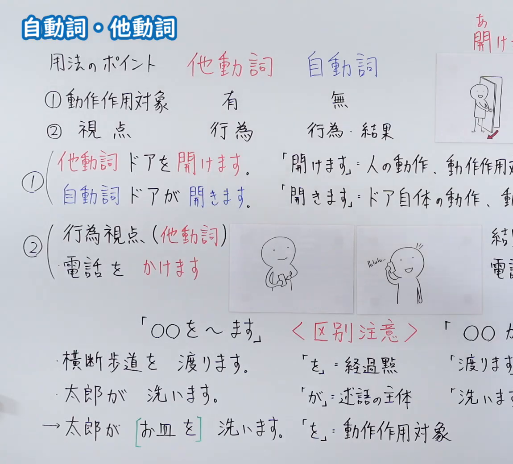
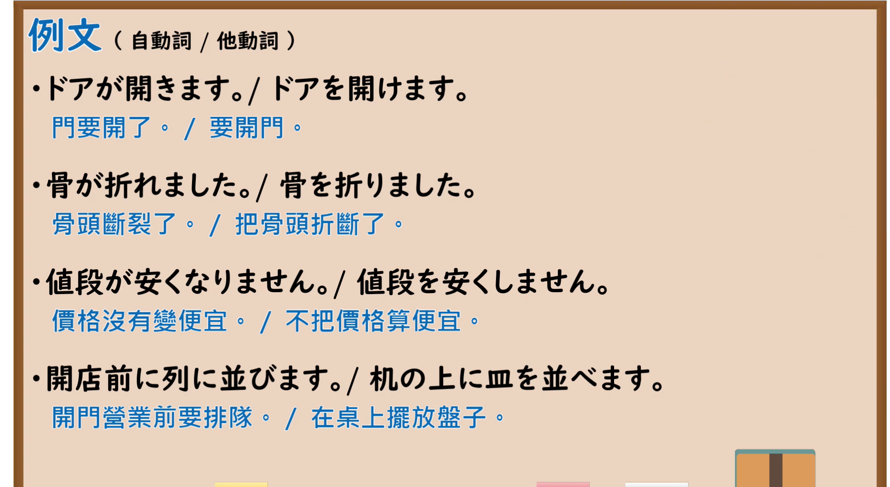

---
{
  "id": "N5-G-0114",
  "kind": "grammar",
  "level": "N5",
  "title": "自动词・他动词",
  "card_revision": 2,
  "schema_version": 1,
  "source": {
    "lesson": "N5 第114个语法",
    "material": "出口日語原视频板书（学习者截取的接续图与例句图）与Anne日本語「自動詞・他動詞の違いと見分け方」正文",
    "video": "https://www.youtube.com/watch?v=RCbHfU5L4Wg",
    "screenshot": "assets/grammar/n5/N5-G-0114-connection.png",
    "screenshot_crop": {
      "x": 0,
      "y": 0,
      "width": 1150,
      "height": 1040
    }
  },
  "tags": [
    "自动词",
    "他动词",
    "自他ペア",
    "N5"
  ],
  "confusions": [
    "を／が",
    "行為視点／結果視点",
    "ドアを開ける／ドアが開く",
    "を＝他动词とは限らない"
  ]
}
---

# N5 第114个语法：自动词・他动词

# 视频学习资料整理

- 课程：[出口日語「自動詞・他動詞」](https://www.youtube.com/watch?v=RCbHfU5L4Wg)
- 视频 ID：`RCbHfU5L4Wg`
- 视频时长：8分34秒

## 接续图

- 实际时间：未记录（图片由学习者从原视频截取并提供）
- 成品图尺寸：1150×1040，固定左上角 `(0, 0)`，右下角 `(1150, 1040)`
- 板书内容：标题「自動詞・他動詞」；表格「用法のポイント」：他動詞（红）／自動詞（蓝）：「①動作作用対象：有／無」「②視点：行為／行為・結果」；①对比：「他動詞 ドアを開けます。」（「開けます＝人の動作、動作作用対（象）」）「自動詞 ドアが開きます。」（「開きます＝ドア自体の動作、動（作）」）；右上角手绘「開け…」小图；②「行為視点（他動詞）」：「電話をかけます」配两幅手绘图；右侧「結果（視点）」「電話…」被截断；红字「＜区別注意＞」：「「○○を～ます」」「横断歩道を渡ります。」「「を」＝経過點」；「太郎が洗います。」「「が」＝述語の主体」；「→太郎が［お皿を］洗います。」「「を」＝動作作用対象」；右侧「○○が…」「渡ります」「洗いま（す）」被画面右缘截断，未补写。

## 例句图

- 实际时间：未记录（图片由学习者从原视频截取并提供）
- 成品图尺寸：1900×1040，固定左上角 `(0, 0)`，右下角 `(1900, 1040)`
- 板书内容：课程「例文」页，标题「例文（自動詞／他動詞）」，含四组自动词／他动词对照句及中文翻译（ドアが開きます。／ドアを開けます。／骨が折れました。／骨を折りました。／値段が安くなりません。／値段を安くしません。／開店前に列に並びます。／机の上に皿を並べます。）。四组均完整可见。

# 核心

## 功能一：自动词与他动词的区别（有无动作作用对象、行为视点与结果视点）

**くわしい意味記述：**

- **「を」だけでは判断できない：** 助詞「を」は、動作の対象だけを表すわけではありません。「空を飛ぶ」の「空」は通過する場所、「家を出る」の「家」は出発する場所で、「飛ぶ」「出る」は自動詞です。（助词「を」并不只表示动作的对象。「空を飛ぶ」的「空」是通过的场所，「家を出る」的「家」是出发的场所，「飛ぶ」「出る」是自动词。）
- **原因側・結果側：** 自他ペアは、一つの出来事を違う側から表しています。他動詞「開ける」＝原因側（人が対象に働きかける）、自動詞「開く」＝結果側（対象に動き・変化が起こる）。（自他对是从不同侧面表达同一件事。他动词「開ける」＝原因侧（人对对象施加作用），自动词「開く」＝结果侧（对象发生动作、变化）。）

### 例句

1. （人が）ドアを開ける　→　（ドアが）開く

   （（人）开门　→　（门）开了）

2. （人が）電気を消す

   （（人）关灯）

3. 空を飛ぶ

   （在天空飞（「を」表示通过的场所，「飛ぶ」是自动词））

4. 家を出る

   （离开家（「を」表示出发的场所，「出る」是自动词））

# 来源

- [出口日語原视频](https://www.youtube.com/watch?v=RCbHfU5L4Wg)
- [Anne日本語「自動詞・他動詞の違いと見分け方」](https://www.anne-nihongo.com/jidoushi-tadoushi-miwakekata/)（查询日期：2026-10-16；Hagoromo、毎日のんびり日本語教師、日本語NET 均未找到直接对应条目，按流程采用互联网检索所得的该页；该页是教师向的分类讲解，只有 4 条词组式例子，不是完整句子，卡内「例句」如实照录；译文为整理者所译；板书的「視点」说明（行為／行為・結果）与「電話をかけます」图例该页未解说）
