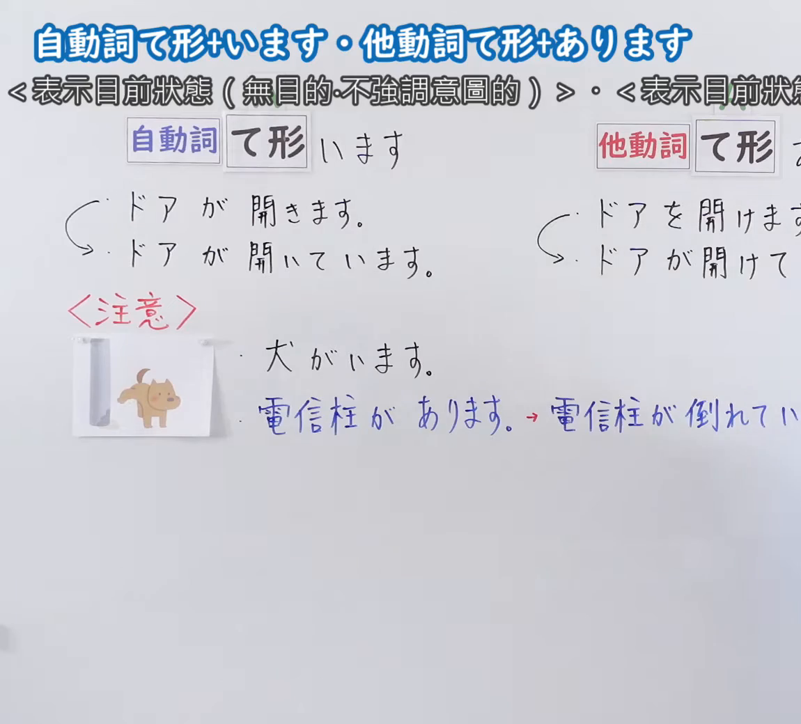
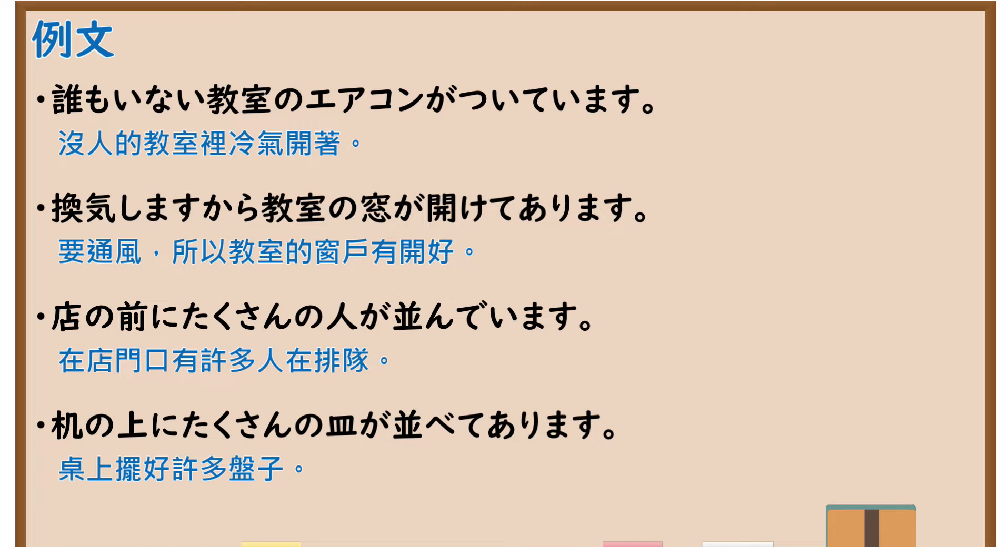

---
{
  "id": "N5-G-0115",
  "kind": "grammar",
  "level": "N5",
  "title": "自动词て形＋います・他动词て形＋あります",
  "card_revision": 2,
  "schema_version": 1,
  "source": {
    "lesson": "N5 第115个语法",
    "material": "出口日語原视频板书（学习者截取的接续图与例句图）与东京外国语大学「Vています（状態）」「Vてあります」解说正文",
    "video": "https://www.youtube.com/watch?v=pNEGlpxa7ys",
    "screenshot": "assets/grammar/n5/N5-G-0115-connection.png",
    "screenshot_crop": {
      "x": 0,
      "y": 0,
      "width": 1150,
      "height": 1040
    }
  },
  "tags": [
    "ています",
    "てあります",
    "结果状态",
    "自他",
    "N5"
  ],
  "confusions": [
    "ている／てある",
    "自动词／他动词",
    "無目的／有意图",
    "着いています"
  ]
}
---

# N5 第115个语法：自动词て形＋います・他动词て形＋あります

# 视频学习资料整理

- 课程：[出口日語「自動詞て形＋います・他動詞て形＋あります」](https://www.youtube.com/watch?v=pNEGlpxa7ys)
- 视频 ID：`pNEGlpxa7ys`
- 视频时长：7分11秒

## 接续图

- 实际时间：未记录（图片由学习者从原视频截取并提供）
- 成品图尺寸：1150×1040，固定左上角 `(0, 0)`，右下角 `(1150, 1040)`
- 板书内容：标题「自動詞て形＋います・他動詞て形＋あります」，副标「＜表示目前狀態（無目的・不強調意圖的）＞・＜表示目前狀態…」（右端被画面右缘截断）；公式「自動詞 て形 います」「他動詞 て形 あ（ります）」；例句：「ドアが開きます。」→「ドアが開いています。」「ドアを開けます。」→「ドアが開けて（あります）」（右端被截断）；红字「＜注意＞」：配手绘小狗图「犬がいます。」「電信柱があります。→電信柱が倒れてい（ます）」，右端被画面右缘截断，未补写。

## 例句图

- 实际时间：未记录（图片由学习者从原视频截取并提供）
- 成品图尺寸：1900×1040，固定左上角 `(0, 0)`，右下角 `(1900, 1040)`
- 板书内容：课程「例文」页，含四条例句及中文翻译（誰もいない教室のエアコンがついています／換気しますから教室の窓が開けてあります／店の前にたくさんの人が並んでいます／机の上にたくさんの皿が並べてあります）。四条例句均完整可见。

# 核心

## 功能一：表示目前状态（自动词＋ています／他动词＋てあります）

**くわしい意味記述：**

- **Vています（状態）：** 「Vています」は、変化の結果の状態を表わすことがあります。「Nは／が」がさす人やものが変化して、結果を残すタイプの動詞に限られます。例：開く、閉まる、われる、落ちる、（電気が）つく、消える。（「Vています」有时表示变化结果的状态。限于「Nは／が」所指的人或物发生变化并留下结果的那类动词。如：開く、閉まる、われる、落ちる、（電気が）つく、消える。）
- **Vてあります：** 「Vてあります」は、意図的な働きかけの結果変化したNの状態を表わすときに使います。「Vてあります」は、働きかけをした人が重要なのではなく、変化の結果の状態のみに注目しています。Vは「を（対象）」を取り、対象を変化させる動詞に限られます。（「Vてあります」用于表示因有意图的作用而发生变化的N的状态。重点不在施加作用的人，而只关注变化结果的状态。V限于带「を（对象）」、使对象发生变化的动词。）

### 例句

1. 体育館の前に小林さんが立っています。

   （体育馆前站着小林。）

2. 窓が開いています。

   （窗户开着。）

3. 窓が閉めてあります。

   （窗户关着（有人关好了）。）

4. 電気が消してありました。

   （灯被关掉了。）

5. 駅のホームに新しい映画のポスターがはってありました。

   （车站月台上贴着新电影的海报。）

# 来源

- [出口日語原视频](https://www.youtube.com/watch?v=pNEGlpxa7ys)
- 东京外国语大学「日本語 文法」解说：[「Vています（状態）」](https://www.coelang.tufs.ac.jp/mt/ja/gmod/contents/explanation/045.html)、[「Vてあります」](https://www.coelang.tufs.ac.jp/mt/ja/gmod/courses/c02/lesson24/step2/explanation/046.html)（查询日期：2026-10-16；Hagoromo、毎日のんびり日本語教師、日本語NET 均未找到直接对应条目，按流程采用互联网检索所得的两页；例句译文为整理者所译；板书中「犬がいます」「電信柱があります→倒れています」的注意事项两页未解说）
