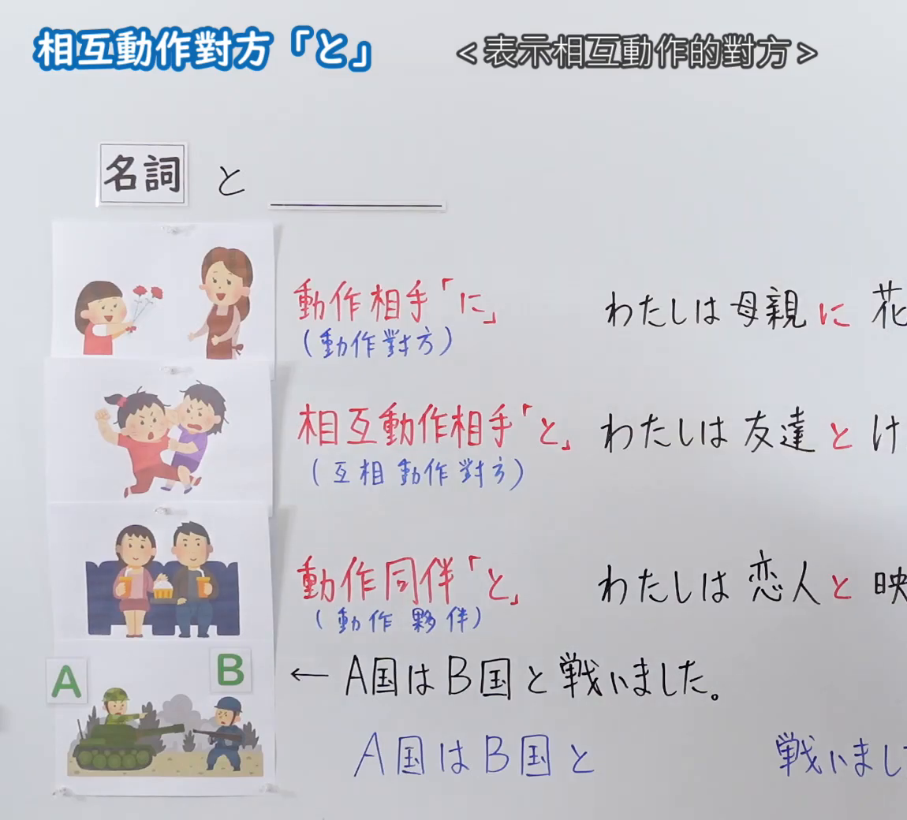
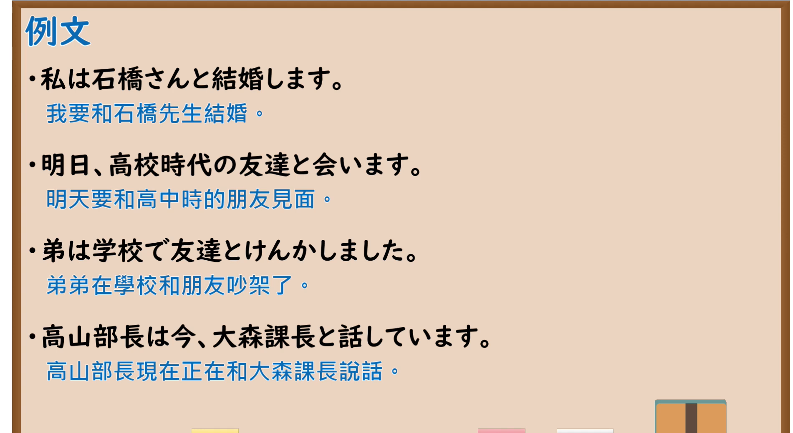

---
{
  "id": "N5-G-0116",
  "kind": "grammar",
  "level": "N5",
  "title": "相互动作对方「と」",
  "card_revision": 2,
  "schema_version": 1,
  "source": {
    "lesson": "N5 第116个语法",
    "material": "出口日語原视频板书（学习者截取的接续图与例句图）与毎日のんびり日本語教師「格助詞「と」の用法一覧」正文",
    "video": "https://www.youtube.com/watch?v=ERrXSu70wtw",
    "screenshot": "assets/grammar/n5/N5-G-0116-connection.png",
    "screenshot_crop": {
      "x": 0,
      "y": 0,
      "width": 1150,
      "height": 1040
    }
  },
  "tags": [
    "と",
    "相互动作",
    "动作伙伴",
    "N5"
  ],
  "confusions": [
    "に／と",
    "动作相手／相互动作相手／动作同伴",
    "と／といっしょに",
    "结婚する／けんかする"
  ]
}
---

# N5 第116个语法：相互动作对方「と」

# 视频学习资料整理

- 课程：[出口日語「相互動作対方「と」」](https://www.youtube.com/watch?v=ERrXSu70wtw)
- 视频 ID：`ERrXSu70wtw`
- 视频时长：8分49秒

## 接续图

- 实际时间：未记录（图片由学习者从原视频截取并提供）
- 成品图尺寸：1150×1040，固定左上角 `(0, 0)`，右下角 `(1150, 1040)`
- 板书内容：标题「相互動作對方「と」」，右侧标注“＜表示相互動作的對方＞”；公式「名詞 と ＿＿」；三类配手绘图：「動作相手「に」（動作對方）」：「わたしは母親に花（を…）」（图：女孩把花递给母亲）；「相互動作相手「と」（互相動作對方）」：「わたしは友達とけ（んかしました）」（图：两个孩子打架）；「動作同伴「と」（動作夥伴）」：「わたしは恋人と映（画を…）」（图：情侣并排看电影）；下方军人手绘图：「←A国はB国と戦いました。」「A国はB国と　　戦いまし（た）」；右端均被画面右缘截断，未补写。

## 例句图

- 实际时间：未记录（图片由学习者从原视频截取并提供）
- 成品图尺寸：1900×1040，固定左上角 `(0, 0)`，右下角 `(1900, 1040)`
- 板书内容：课程「例文」页，含四条例句及中文翻译（私は石橋さんと結婚します／明日、高校時代の友達と会います／弟は学校で友達とけんかしました／高山部長は今、大森課長と話しています）。四条例句均完整可见。

# 核心

## 功能一：表示相互动作的对方

**くわしい意味記述：**

- **相互動作の相手：** 述語に相互動詞がくるとき、相互動詞が表す動作の実現に必須な当事者を「と」で表します。例えば「結婚する」という動作は必ず相手があってこそ可能な動作であり、その相手を「と」で表します。相互動詞が表す動作の相手は「と一緒に」「とともに」で表すことはできません。（谓语是相互动词时，用「と」表示实现该相互动作所必需的当事人。例如「結婚する」必须有对象才能进行，该对象用「と」表示。相互动词所表示动作的对象不能用「と一緒に」「とともに」表示。）

### 例句

1. 私はいつか彼女と結婚したいと思っている。

   （我希望有一天能和她结婚。）

2. 法廷でＡ氏と争うことにした。

   （我决定在法庭上与A先生争论。）

3. 些細な事で友達と喧嘩した。

   （我因为一些小事和朋友吵架了。）

4. 彼と別れた。

   （我和他分手了。）

5. クラスメートと話し合う。

   （和同学讨论。）

# 来源

- [出口日語原视频](https://www.youtube.com/watch?v=ERrXSu70wtw)
- [毎日のんびり日本語教師「格助詞「と」の用法一覧」「相互動作の相手」](https://mainichi-nonbiri.com/jltct/to-case-particle/)（查询日期：2026-10-16；Hagoromo 未收录，按流程采用优先级最高的备选网站该页，中文译文取自该页；与第 16 课「共同動作の相手」同一页的另一小节；板书中「に」「と」「と（同伴）」的三类对比图示该页只在文字上区分相互动作与共同动作）
