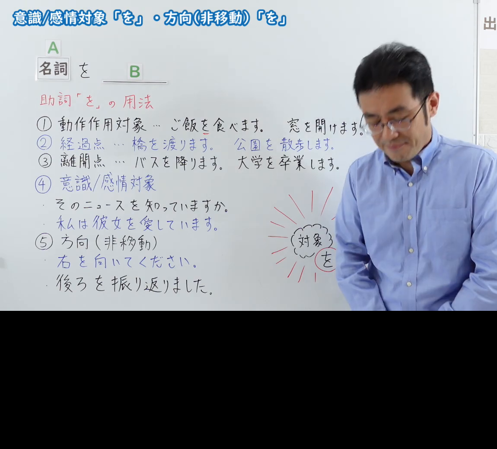
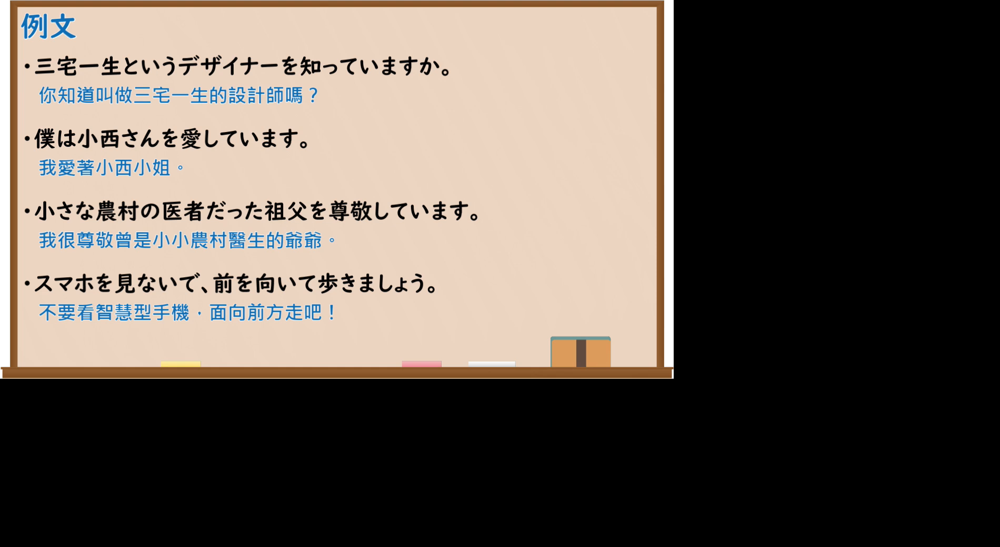

---
{
  "id": "N5-G-0117",
  "kind": "grammar",
  "level": "N5",
  "title": "意识／感情对象「を」・方向（非移动）「を」",
  "card_revision": 2,
  "schema_version": 1,
  "source": {
    "lesson": "N5 第117个语法",
    "material": "出口日語原视频板书（学习者截取的接续图与例句图）与东京外国语大学「格助詞：解説」「を」正文",
    "video": "https://www.youtube.com/watch?v=DIJZVXAFn_w",
    "screenshot": "assets/grammar/n5/N5-G-0117-connection.png",
    "screenshot_crop": {
      "x": 0,
      "y": 0,
      "width": 1150,
      "height": 1040
    }
  },
  "tags": [
    "を",
    "意识对象",
    "感情对象",
    "方向",
    "N5"
  ],
  "confusions": [
    "动作作用对象／经过点／离开点",
    "知っています／愛しています",
    "右を向く",
    "を／に"
  ]
}
---

# N5 第117个语法：意识・感情对象「を」与方向（非移动）「を」

# 视频学习资料整理

- 课程：[出口日語「意識／感情対象「を」・方向（非移動）「を」」](https://www.youtube.com/watch?v=DIJZVXAFn_w)
- 视频 ID：`DIJZVXAFn_w`
- 视频时长：8分7秒

## 接续图

- 实际时间：未记录（图片由学习者从原视频截取并提供）
- 成品图尺寸：1150×1040，固定左上角 `(0, 0)`，右下角 `(1150, 1040)`
- 板书内容：标题「意識／感情対象「を」・方向（非移動）「を」」；公式「A：名詞 を B：＿＿」；红字「助詞「を」の用法」：「①動作作用対象…ご飯を食べます。窓を開けます。」「②経過点…橋を渡ります。公園を散歩します。」「③離開点…バスを降ります。大学を卒業します。」「④意識／感情対象」：「そのニュースを知っていますか。」「私は彼女を愛しています。」「⑤方向（非移動）」：「右を向いてください。」「後ろを振り返りました。」；右侧手绘云朵“対象を”。注：本图是原视频整帧，下方约三分之一为黑边，老师入画，遮挡右侧「窓を開けます。」「公園を散歩します。」「大学を卒業します。」的句末。

## 例句图

- 实际时间：未记录（图片由学习者从原视频截取并提供）
- 成品图尺寸：1900×1040，固定左上角 `(0, 0)`，右下角 `(1900, 1040)`
- 板书内容：课程「例文」页，含四条例句及中文翻译（三宅一生というデザイナーを知っていますか／僕は小西さんを愛しています／小さな農村の医者だった祖父を尊敬しています／スマホを見ないで、前を向いて歩きましょう）。四条例句均完整可见；本图同样带下方黑边，实际黑板内容在上方约 2/3。

# 核心

## 功能一：表示意识、感情的对象；表示方向（不伴随移动）

**くわしい意味記述：**

- **を（対象・出発点・通過点）：** 他動詞の表わす動作の対象を表わすほか、移動の出発点や通過点・経路を表わします。出発点の用法の拡張として、離脱する組織などを表わすこともあります。（除表示他动词所表示动作的对象外，也表示移动的出发点、通过点、路径。作为出发点用法的扩展，也表示要离开的组织等。）

### 例句

1. 山田さんが本を読みました。（動作の対象）

   （山田读了书。（动作对象））

2. ９時に家を出ます。（出発点）

   （9点离开家。（出发点））

3. 十字路を右に曲がります。（通過点）

   （在十字路口向右拐。（通过点））

4. 大学を卒業します。

   （从大学毕业。）

5. 楽しい１日を過ごしました。

   （度过了愉快的一天。）

# 来源

- [出口日語原视频](https://www.youtube.com/watch?v=DIJZVXAFn_w)
- [东京外国语大学「日本語 文法 格助詞：解説」「を」](https://www.coelang.tufs.ac.jp/mt/ja/gmod/contents/explanation/053.html)（查询日期：2026-10-16；Hagoromo、毎日のんびり日本語教師、日本語NET 均未找到直接对应条目，按流程采用互联网检索所得的该页；该页没有「意識／感情対象のを」（知る、愛する）和「方向（非移動）のを」（右を向く）的单独解说，卡内只有第一项，已省略无来源的内容，需要你另找来源补充；例句译文为整理者所译）
