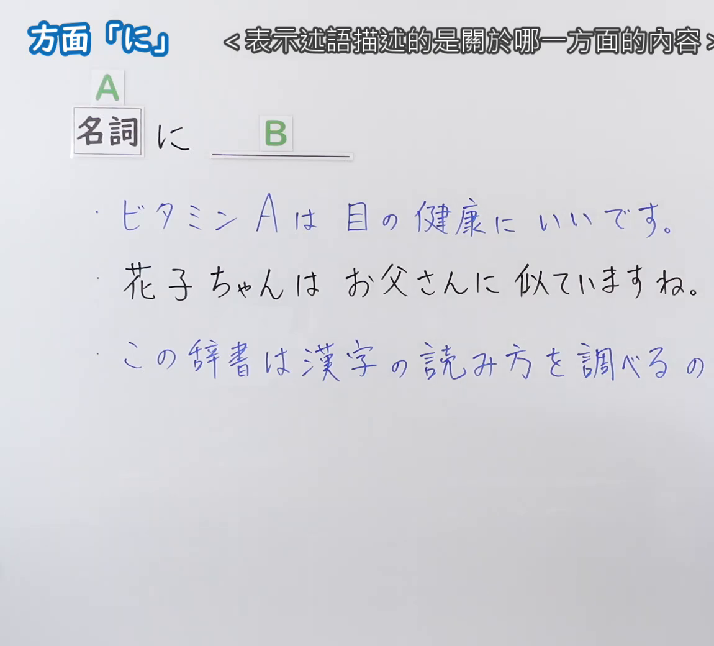
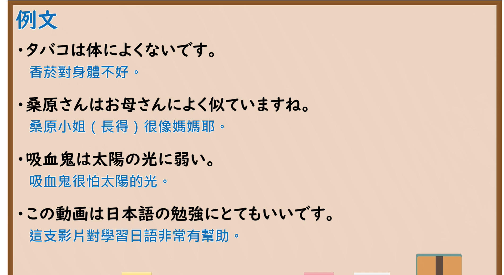

---
{
  "id": "N5-G-0118",
  "kind": "grammar",
  "level": "N5",
  "title": "方面「に」",
  "card_revision": 2,
  "schema_version": 1,
  "source": {
    "lesson": "N5 第118个语法",
    "material": "出口日語原视频板书（学习者截取的接续图与例句图）与毎日のんびり日本語教師「格助詞「に」の用法一覧」与东京外国语大学「格助詞：解説」正文",
    "video": "https://www.youtube.com/watch?v=pRXAifoJlsg",
    "screenshot": "assets/grammar/n5/N5-G-0118-connection.png",
    "screenshot_crop": {
      "x": 0,
      "y": 0,
      "width": 1150,
      "height": 1040
    }
  },
  "tags": [
    "に",
    "方面",
    "基准",
    "N5"
  ],
  "confusions": [
    "に／で",
    "似ている／強い／弱い",
    "体にいい",
    "基準／適用範囲"
  ]
}
---

# N5 第118个语法：助词「に」（方面）

# 视频学习资料整理

- 课程：[出口日語「方面「に」」](https://www.youtube.com/watch?v=pRXAifoJlsg)
- 视频 ID：`pRXAifoJlsg`
- 视频时长：4分10秒

## 接续图

- 实际时间：未记录（图片由学习者从原视频截取并提供）
- 成品图尺寸：1150×1040，固定左上角 `(0, 0)`，右下角 `(1150, 1040)`
- 板书内容：标题「方面「に」」，右侧标注“＜表示述語描述的是關於哪一方面的內容＞”；公式「A：名詞 に B：＿＿」；例句：「ビタミンAは目の健康にいいです。」「花子ちゃんはお父さんに似ていますね。」「この辞書は漢字の読み方を調べるの（に…）」（右端被画面右缘截断）。

## 例句图

- 实际时间：未记录（图片由学习者从原视频截取并提供）
- 成品图尺寸：1900×1040，固定左上角 `(0, 0)`，右下角 `(1900, 1040)`
- 板书内容：课程「例文」页，含四条例句及中文翻译（タバコは体によくないです／桑原さんはお母さんによく似ていますね／吸血鬼は太陽の光に弱い／この動画は日本語の勉強にとてもいいです）。四条例句均完整可见。

# 核心

## 功能一：表示谓语所描述的是关于哪一方面的内容（基准、适用范围）

**くわしい意味記述：**

- **基準：** 主語の性質や状態を述べるための基準となるものを「に」で表します。（用「に」表示叙述主语的性质、状态时的基准。）
- **比較の基準・適用の範囲：** 比較の基準や適用の範囲を表わします。例：山田さんはお父さんに似ています。テレビは目によくないです。（表示比较的基准或适用的范围。）

### 例句

1. 私の家は駅に近い。

   （我家离火车站近。）

2. 私は父に似ていない。

   （我不像我父亲。）

3. 国内の選手は海外で活躍する選手に劣る。

   （国内选手不及在海外活跃的选手。）

4. 山田さんはお父さんに似ています。

   （山田像他父亲。）

5. テレビは目によくないです。

   （电视对眼睛不好。）

# 来源

- [出口日語原视频](https://www.youtube.com/watch?v=pRXAifoJlsg)
- [毎日のんびり日本語教師「格助詞「に」の用法一覧」「基準」](https://mainichi-nonbiri.com/jltct/ni-case-particle/)（例1–3，中文译文取自该页）、[东京外国语大学「日本語 文法 格助詞：解説」「に」](https://www.coelang.tufs.ac.jp/mt/ja/gmod/contents/explanation/053.html)（例4、5，译文为整理者所译；查询日期：2026-10-16；Hagoromo 未收录，按流程采用优先级最高的备选网站该页，并以东京外国语大学页补足例句；毎日のんびり日本語教師页没有「にいい／にいいです」「に強い／弱い」类例句）
