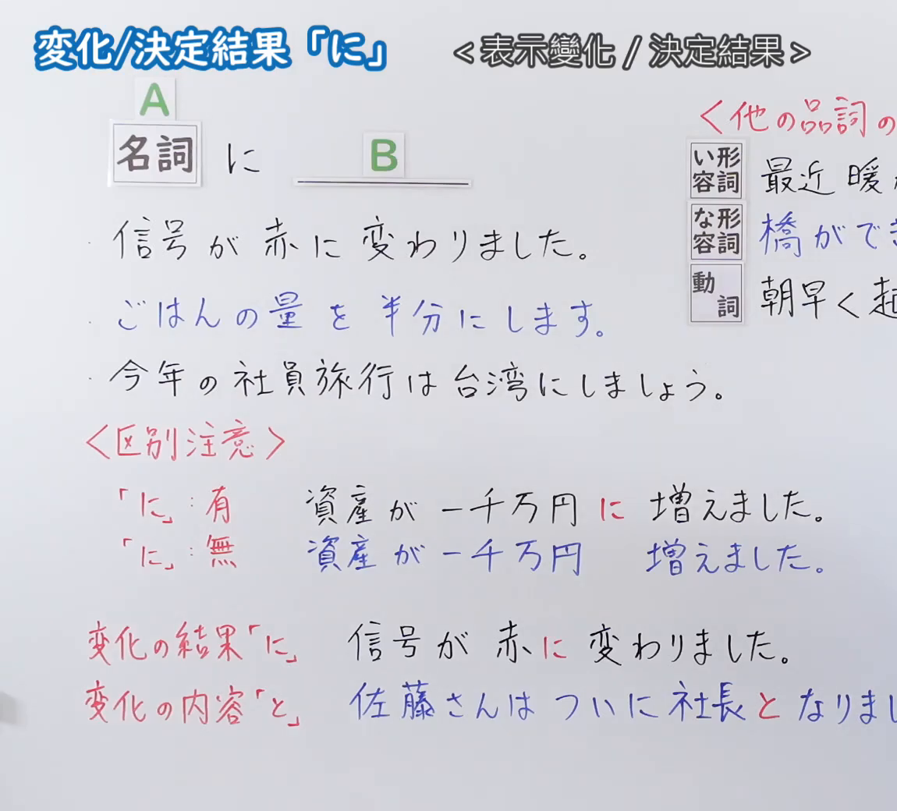
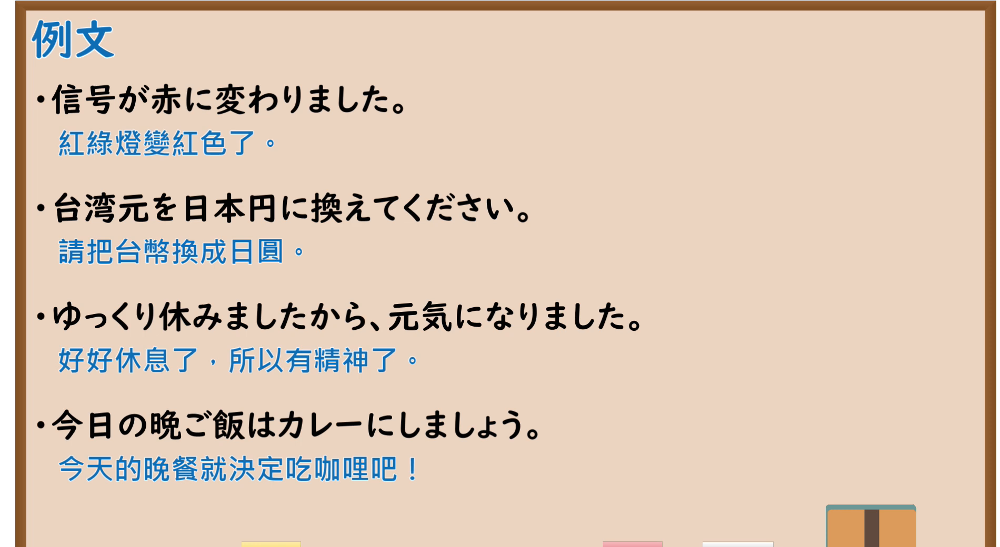

---
{
  "id": "N5-G-0119",
  "kind": "grammar",
  "level": "N5",
  "title": "变化／决定结果「に」",
  "card_revision": 2,
  "schema_version": 1,
  "source": {
    "lesson": "N5 第119个语法",
    "material": "出口日語原视频板书（学习者截取的接续图与例句图）与毎日のんびり日本語教師「格助詞「に」の用法一覧」正文",
    "video": "https://www.youtube.com/watch?v=j63rRWLkVYk",
    "screenshot": "assets/grammar/n5/N5-G-0119-connection.png",
    "screenshot_crop": {
      "x": 0,
      "y": 0,
      "width": 1150,
      "height": 1040
    }
  },
  "tags": [
    "に",
    "变化",
    "结果",
    "决定",
    "N5"
  ],
  "confusions": [
    "に／と（变化の内容）",
    "になる／にする",
    "に有／に無",
    "いい形容词＋く"
  ]
}
---

# N5 第119个语法：助词「に」（变化／决定结果）

# 视频学习资料整理

- 课程：[出口日語「変化／決定結果「に」」](https://www.youtube.com/watch?v=j63rRWLkVYk)
- 视频 ID：`j63rRWLkVYk`
- 视频时长：9分26秒

## 接续图

- 实际时间：未记录（图片由学习者从原视频截取并提供）
- 成品图尺寸：1150×1040，固定左上角 `(0, 0)`，右下角 `(1150, 1040)`
- 板书内容：标题「変化/決定結果「に」」，右侧标注“＜表示變化／決定結果＞”；公式「A：名詞 に B：＿＿」；例句：「信号が赤に変わりました。」「ごはんの量を半分にします。」（蓝字）「今年の社員旅行は台湾にしましょう。」；右侧红字「＜他の品詞の…」下：「い形容詞：最近暖か（く…）」「な形容詞：橋ができ…」「動詞：朝早く起…」，被画面右缘截断；红字「＜区別注意＞」：「「に」：有　資産が一千万円に増えました。」「「に」：無　資産が一千万円　増えました。」；「変化の結果「に」：信号が赤に変わりました。」「変化の内容「と」：佐藤さんはついに社長となりま（した）」（被截断）。

## 例句图

- 实际时间：未记录（图片由学习者从原视频截取并提供）
- 成品图尺寸：1900×1040，固定左上角 `(0, 0)`，右下角 `(1900, 1040)`
- 板书内容：课程「例文」页，含四条例句及中文翻译（信号が赤に変わりました／台湾元を日本円に換えてください／ゆっくり休みましたから、元気になりました／今日の晩ご飯はカレーにしましょう）。四条例句均完整可见。

# 核心

## 功能一：表示变化的结果、决定的结果

**くわしい意味記述：**

- **変化の結果：** 変化主体が何か別のものに変わることを表す「変える」「変化する」「化ける」「なる」などの変化動詞が述語にくるとき、変化主体の変化の結果を「に」で表します。「と」でも表すことができます。「と」を使うと書き言葉的になります。（谓语是「変える」「変化する」「化ける」「なる」等表示变化主体变成别的东西的变化动词时，用「に」表示变化的结果。也可用「と」，用「と」则偏书面语。）

### 例句

1. 雪が雨に変わった。

   （雪变成了雨。）

2. 子供を公務員にしたい。

   （想让孩子成为公务员。）

3. 目が合うと石にされる。

   （对上眼就会被变成石头。）

4. 肉が焦げて真っ黒になった。

   （肉烧焦了变得漆黑。）

5. １２時になりました。

   （到12点了。）

# 来源

- [出口日語原视频](https://www.youtube.com/watch?v=j63rRWLkVYk)
- [毎日のんびり日本語教師「格助詞「に」の用法一覧」「変化の結果」](https://mainichi-nonbiri.com/jltct/ni-case-particle/)（查询日期：2026-10-16；Hagoromo 未收录，按流程采用优先级最高的备选网站该页，中文译文取自该页；该小节只有「変化の結果」，没有板书中“决定结果”（社員旅行は台湾にしましょう／カレーにします）的单独解说，可参见第 19 课；板书的「に有／に無」「に／と」区别该页只在「と」的一句话提及）
