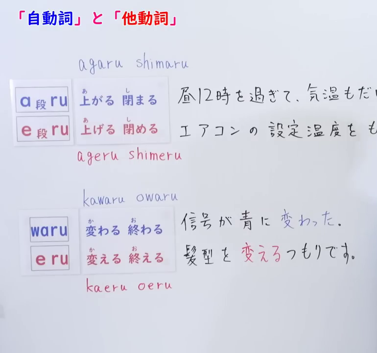
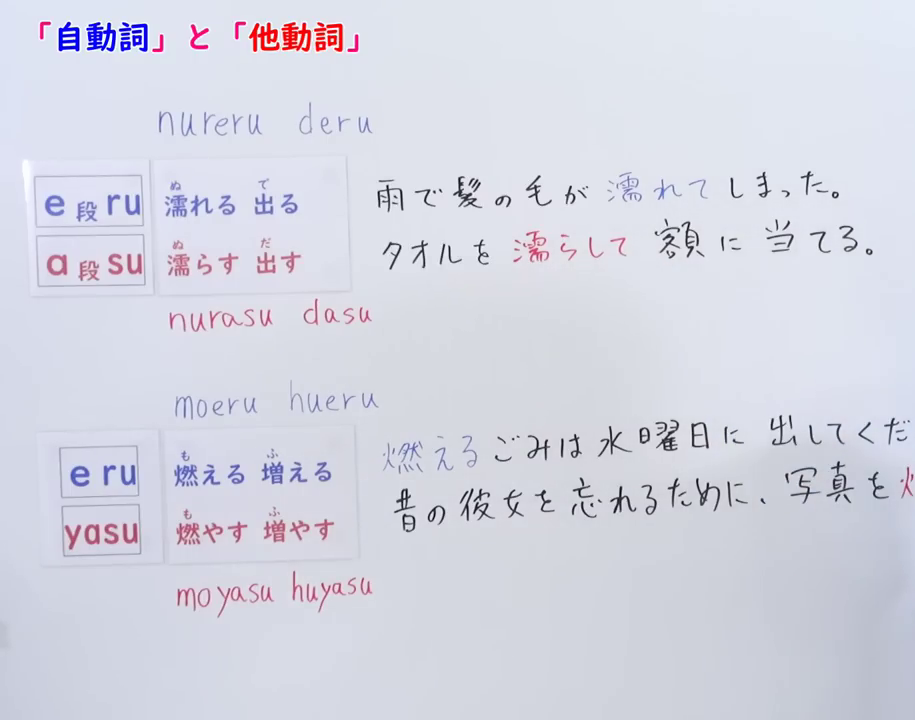
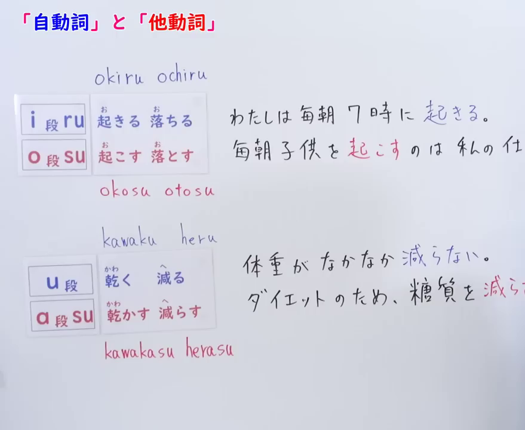
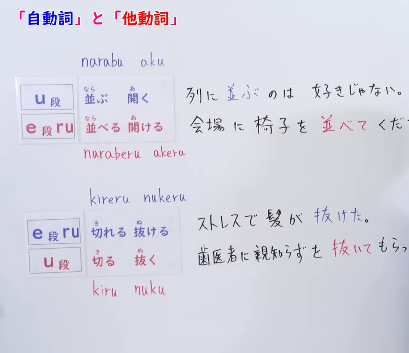
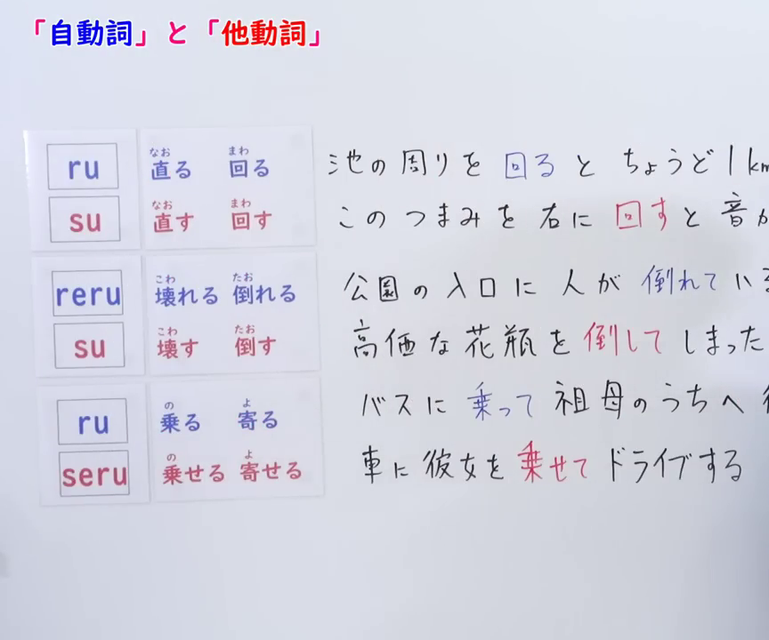
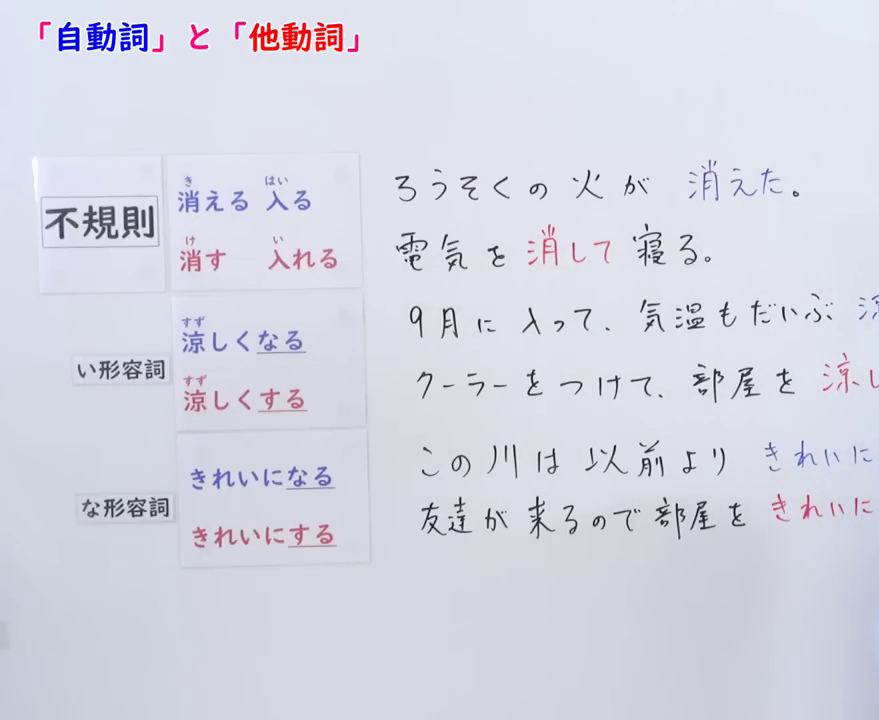
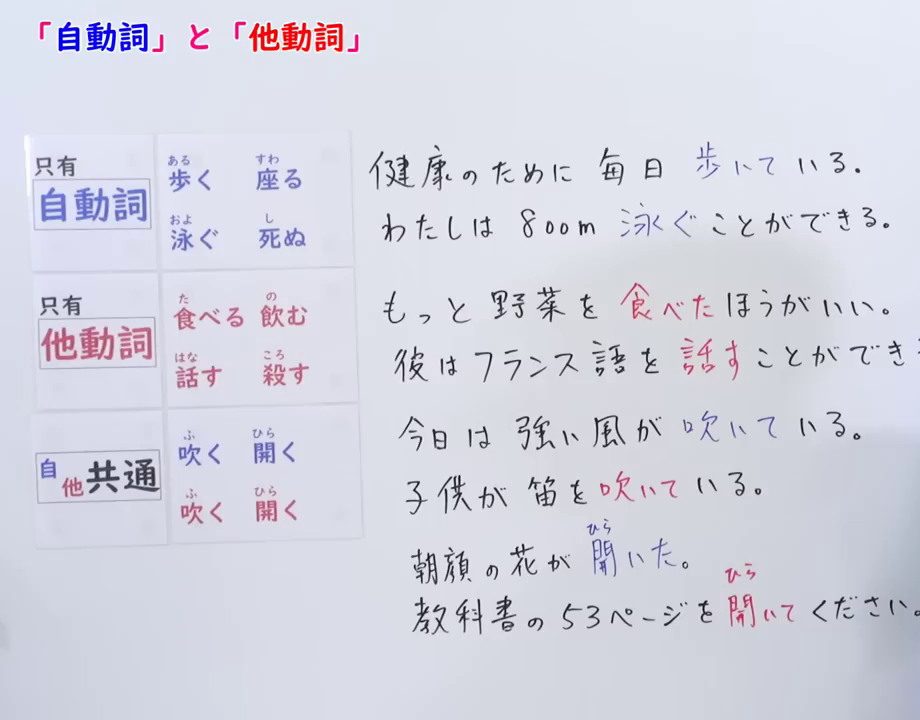

# 自他动词配对总结｜出口日语

视频：[日本語一問一答［009］自動詞・他動詞（後編）](https://www.youtube.com/watch?v=NGeeHjP9axg)。以下依据指定时间点的画面整理。

**颜色约定：🔵 自动词，🔴 他动词。** 使用蓝、红圆点标记，表格同时保留自他属性的文字标签。

自动词侧重事物发生的动作或变化；他动词侧重对对象施加动作。记忆时把词义、读音和自他属性一起记，不只看词尾。

**记号说明：**「あ段／い段／う段／え段／お段」表示五十音的元音段，不是直接添加「あ／い／う／え／お」这个假名。例如「しまる」中的「ま」属于あ段，「しめる」中的「め」属于え段。下列规则是视频中已有词对的归类，不能用来任意造词。

## 第一组：あ段＋る ↔ え段＋る（0:01）



*第一组及特例共用此画面；截图时间 0:01。*

| 🔵 自动词：あ段＋る | 🔴 他动词：え段＋る | 词义对照 |
|---|---|---|
| 🔵 あがる（上がる） | 🔴 あげる（上げる） | 上升／提高、抬高 |
| 🔵 しまる（閉まる） | 🔴 しめる（閉める） | 关闭／关上 |

### 画面下方的特例：わる ↔ える

这里按整个「わる」与「える」对应来记，不把「わ」机械地替换为「え」。

| 🔵 自动词：わる | 🔴 他动词：える | 词义对照 |
|---|---|---|
| 🔵 かわる（変わる） | 🔴 かえる（変える） | 改变／改变某物 |
| 🔵 おわる（終わる） | 🔴 おえる（終える） | 结束／完成、结束某事 |

视频例句：

- 🔵 信号が青に変わった。（信号灯变绿了。）
- 🔴 髪型を変えるつもりです。（我打算换个发型。）

## 第二组：え段＋る ↔ あ段＋す（7:24）



*第二组及特例共用此画面；截图时间 7:27。*

| 🔵 自动词：え段＋る | 🔴 他动词：あ段＋す | 词义对照 |
|---|---|---|
| 🔵 ぬれる（濡れる） | 🔴 ぬらす（濡らす） | 变湿／弄湿 |
| 🔵 でる（出る） | 🔴 だす（出す） | 出来、出去／拿出、使出去 |

### 画面下方的特例：える ↔ やす

| 🔵 自动词：える | 🔴 他动词：やす | 词义对照 |
|---|---|---|
| 🔵 もえる（燃える） | 🔴 もやす（燃やす） | 燃烧／烧掉、焚烧 |
| 🔵 ふえる（増える） | 🔴 ふやす（増やす） | 增加／增加某物的数量 |

视频例句：

- 🔵 雨で髪の毛が濡れてしまった。（头发被雨淋湿了。）
- 🔴 タオルを濡らして額に当てる。（把毛巾弄湿后敷在额头上。）

## 第三组：い段＋る ↔ お段＋す（12:07，上半部分）



*第三组和第四组共用此画面；截图时间 12:10。*

| 🔵 自动词：い段＋る | 🔴 他动词：お段＋す | 词义对照 |
|---|---|---|
| 🔵 おきる（起きる） | 🔴 おこす（起こす） | 起床、发生／叫醒、引起 |
| 🔵 おちる（落ちる） | 🔴 おとす（落とす） | 掉落／使掉落、弄掉 |

视频例句：

- 🔵 わたしは毎朝7時に起きる。（我每天早上七点起床。）
- 🔴 毎朝子供を起こすのは私の仕事だ。（每天早上叫孩子起床是我的工作。）

## 第四组：う段结尾 ↔ あ段＋す（12:07，下半部分）

| 🔵 自动词：う段结尾 | 🔴 他动词：あ段＋す | 词义对照 |
|---|---|---|
| 🔵 かわく（乾く） | 🔴 かわかす（乾かす） | 变干／弄干、晾干 |
| 🔵 へる（減る） | 🔴 へらす（減らす） | 减少／减少某物的数量 |

「く→かす」「る→らす」：保留前面的部分，把末尾う段假名换为对应あ段，再加「す」。

视频例句：🔵 体重がなかなか減らない。（体重怎么也减不下来。）

## 第五组：う段结尾 ↔ え段＋る（15:12，上半部分）



*第五组和第六组共用此画面；截图时间 15:12。*

| 🔵 自动词：う段结尾 | 🔴 他动词：え段＋る | 词义对照 |
|---|---|---|
| 🔵 ならぶ（並ぶ） | 🔴 ならべる（並べる） | 排列、排队／排列某物 |
| 🔵 あく（開く） | 🔴 あける（開ける） | 打开／打开某物 |

视频例句：

- 🔵 列に並ぶのは好きじゃない。（我不喜欢排队。）
- 🔴 会場に椅子を並べてください。（请在会场摆好椅子。）

## 第六组：え段＋る ↔ う段结尾（15:12，下半部分）

**这一组与第五组的自他方向相反。** 第五组的「え段＋る」是他动词；这一组的「え段＋る」是自动词。

| 🔵 自动词：え段＋る | 🔴 他动词：う段结尾 | 词义对照 |
|---|---|---|
| 🔵 きれる（切れる） | 🔴 きる（切る） | 断开／切断、剪断 |
| 🔵 ぬける（抜ける） | 🔴 ぬく（抜く） | 脱落、掉落／拔出、抽出 |

视频例句：🔵 ストレスで髪が抜けた。（因为压力，头发掉了。）

记忆对照：**ならぶ〔自〕→ならべる〔他〕；ぬける〔自〕→ぬく〔他〕。** 不能一概把「え段＋る」判为自动词或他动词。

## 第七组：る ↔ す（18:48，上半部分）



*第七组、第八组和第九组共用此画面；截图时间 18:48。*

| 🔵 自动词：る | 🔴 他动词：す | 词义对照 |
|---|---|---|
| 🔵 なおる（直る） | 🔴 なおす（直す） | 修好、恢复正常／修理、改正 |
| 🔵 まわる（回る） | 🔴 まわす（回す） | 转动、绕行／转动某物 |

这里是直接把末尾「る」换成「す」，与第四组的「う段→あ段＋す」分开记。

视频例句：🔵 池の周りを回るとちょうど1kmになる。（绕池塘一圈正好是一公里。）

## 第八组：れる ↔ す（18:48，中间部分）

| 🔵 自动词：れる | 🔴 他动词：す | 词义对照 |
|---|---|---|
| 🔵 こわれる（壊れる） | 🔴 こわす（壊す） | 损坏／弄坏 |
| 🔵 たおれる（倒れる） | 🔴 たおす（倒す） | 倒下／弄倒、打倒 |

与第七组的区别：第七组替换「る」，这一组替换整个「れる」。

视频例句：

- 🔵 公園の入口に人が倒れている。（公园入口处有人倒在那里。）
- 🔴 高価な花瓶を倒してしまった。（不小心把昂贵的花瓶弄倒了。）

## 第九组：る ↔ せる（18:48，下半部分，数量较少）

| 🔵 自动词：る | 🔴 他动词：せる | 词义对照 |
|---|---|---|
| 🔵 のる（乗る） | 🔴 のせる（乗せる） | 乘坐、上车／让人乘坐、装载 |
| 🔵 よる（寄る） | 🔴 よせる（寄せる） | 靠近／使靠近、移到近处 |

按你的说明，这一类数量较少，可把词对直接记住。这里的「のせる／よせる」是配对他动词，不能与使役形混记：「のる」的使役形是「のらせる」，「よる」的使役形是「よらせる」。

视频例句：🔴 車に彼女を乗せてドライブする。（让她上车，一起开车兜风。）

## 第十组：不规则配对（22:58，上半部分）



*第十组、第十一组和第十二组共用此画面；截图时间 23:02。*

| 🔵 自动词 | 🔴 他动词 | 词义对照 |
|---|---|---|
| 🔵 きえる（消える） | 🔴 けす（消す） | 消失、熄灭／消除、关掉 |
| 🔵 はいる（入る） | 🔴 いれる（入れる） | 进入／放入 |

视频把这两对列为「不规则」。尤其注意「はいる／いれる」读音不同，不能只按「入」这个汉字记忆。

视频例句：

- 🔵 ろうそくの火が消えた。（蜡烛的火熄灭了。）
- 🔴 電気を消して寝る。（关灯睡觉。）

## 第十一组：い形容词去い＋くなる ↔ 去い＋くする（22:58，中间部分）

**校对：去掉「い」以后，要加「くなる／くする」，不能直接加「なる／する」。**

| 原形 | 🔵 表示状态变化：去い＋くなる | 🔴 表示使对象变化：去い＋くする |
|---|---|---|
| すずしい（涼しい） | 🔵 すずしくなる（涼しくなる） | 🔴 すずしくする（涼しくする） |

视频例句：

- 🔵 9月に入って、気温もだいぶ涼しくなった。（进入九月，天气也凉快了许多。）
- 🔴 クーラーをつけて、部屋を涼しくする。（打开空调，让房间凉快起来。）

这一组是「形容词＋なる／する」构成的表达，不是把形容词直接变成一对新动词。视频用蓝红两色对照「状态变得……」与「使对象变得……」。

## 第十二组：な形容词词干＋になる ↔ 词干＋にする（22:58，下半部分）

| な形容词 | 🔵 表示状态变化：词干＋になる | 🔴 表示使对象变化：词干＋にする |
|---|---|---|
| きれい（な） | 🔵 きれいになる | 🔴 きれいにする |

如果按「きれいな」来记形容词，接这里的结构时去掉「な」，再加「に」；不说「きれいなになる」。**「きれい」虽然以「い」结尾，仍是な形容词。**

视频例句：🔵 この川は以前よりきれいになった。（这条河比以前干净了。）

第十一、十二组共同对照：**事物が……なる；对象を……する。**

## 补充类型：只有自动词、只有他动词、自他共通（28:45）



*只有自动词、只有他动词和自他共通共用此画面；截图时间 28:45。*

### 只有自动词

画面列出：🔵 あるく（歩く）、すわる（座る）、およぐ（泳ぐ）、しぬ（死ぬ）。

这里的「只有」指这些词本身的自他分类，以及没有本课前述方式的同词根配对他动词，不表示不能构成使役形，也不表示没有意义相关的其他动词。例如「しぬ（死ぬ）」和「ころす（殺す）」意义相关，但不属于前面那些词尾规则的配对。

视频例句：

- 🔵 健康のために毎日歩いている。（为了健康，每天都走路。）
- 🔵 わたしは800m泳ぐことができる。（我能游八百米。）

### 只有他动词

画面列出：🔴 たべる（食べる）、のむ（飲む）、はなす（話す）、ころす（殺す）。

视频例句：

- 🔴 もっと野菜を食べたほうがいい。（最好多吃一些蔬菜。）
- 🔴 彼はフランス語を話すことができる。（他会说法语。）

**他动词的对象在语境明确时可以省略。** 句子没有出现「を」，并不意味着这个词变成了自动词。

### 自他共通：同一个词有自动词、他动词两种用法

| 词 | 🔵 自动词用法 | 🔴 他动词用法 |
|---|---|---|
| ふく（吹く） | 🔵 今日は強い風が吹いている。 — 今天刮着大风。 | 🔴 子供が笛を吹いている。 — 孩子正在吹笛子。 |
| ひらく（開く） | 🔵 朝顔の花が開いた。 — 牵牛花开了。 | 🔴 教科書の53ページを開いてください。 — 请打开课本第五十三页。 |

**读音区别：**第五组是「あく（開く）／あける（開ける）」；这里是「ひらく（開く）」的自他共通用法。汉字相同，读音与归类不同。

## 易混点与 JLPT 考点

- **「る」结尾不决定自他属性。**「あがる」是自动词，「あげる」是他动词；第五、六组更说明同样的词尾关系会有相反方向。
- **「す」结尾的配对词常是他动词，但先确认具体词义和词对。**不能看到词尾就套用所有规则。
- **「が／を」要结合谓语判断。**常见对照是「ドアが閉まる／ドアを閉める」。但视频中的「池の周りを回る」也是自动词用法；这里的「を」标记移动经过的范围，不是他动词的对象。
- **「なる／する」前的形容词接续：**い形容词用「く」，な形容词用「に」；「すずしくなる／きれいになる」是典型对照。
- **配对他动词与使役形分开记。**「のせる」和「のらせる」形式不同，不能把所有带「せる」的词都当成由本课规则产生的使役形。
- **先看词义，再看句子中的用法。**自他共通的「ふく／ひらく」需要结合主语和对象判断，不能为它们固定分配唯一颜色。

## 学习者原文

以下逐字保留本次提供的说明；上文的校对不替换原文。

```text
https://www.youtube.com/watch?v=NGeeHjP9axg 是出口日语讲解的关于自他动词的配对的视频，我要你进行总结并写入根目录下的md文件，蓝色代表自动词，红色代表他动词。0:01 画面就是一组，下面的是特例，例如，在该规则下，わ＋る表示自动词，对应的他动词就是え＋る。7:24 画面又是一组。12:07 有两组。15:12 有两组，这两组注意，是相反的。18:48有三组，第三组很少。22:58 有三组，第一组是不规则，第二组是い形容词去い加なる构成自动词，い形容词去い加する构成他动词。第三组是な形容词加に加なる构成自动词，な形容词加に加する构成他动词。28:45 分别介绍只有自动词、只有他动词和自他共通的类型。该md文件排版：第一组：0:01的画面，第二组：7:24的画面，第三组和第四组：12:07的画面
```
